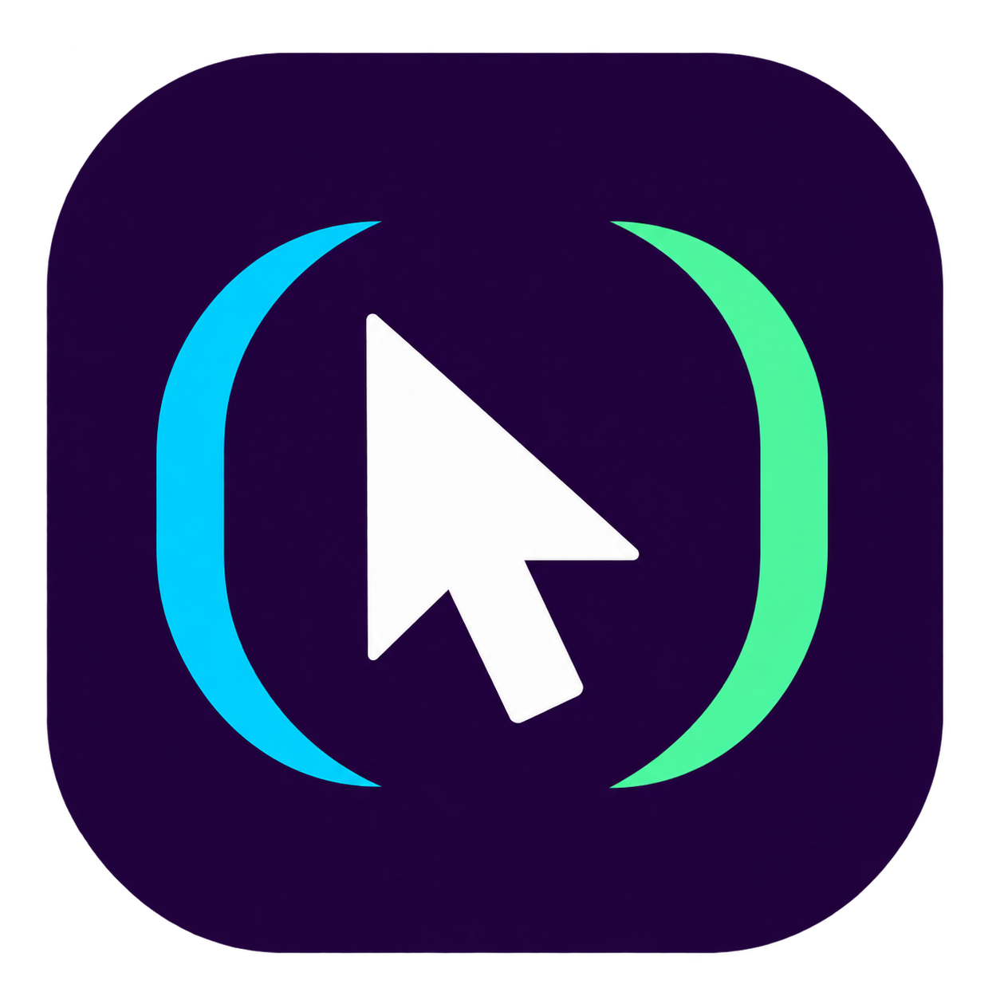

# Stark Dinac



Stark Dinac controla el escritorio con una o dos manos frente a una cámara.
Incluye una aplicación de escritorio para Linux X11 y una versión web con
reproductor de vídeo y editor 3D.

## Aplicación de escritorio para Linux X11

En MX Linux con Xfce y X11 puedes instalar el paquete Debian para 64 bits
y abrir **Stark Dinac** desde el menú. Para ejecutarlo desde el repositorio,
instala Node.js 22 y ejecuta:

```sh
sudo apt install xdotool python3 libxtst6
npm ci
npm run desktop
```

Pulsa **Activar cámara** y elige un dispositivo si aparecen varios. Luego
pulsa **Activar control**. La vista marca la mano **izquierda en azul** y la
**derecha en verde**. Cuando hay dos manos visibles, el puntero sigue la que
ya estabas usando hasta que la bajes.

| Acción                                    | Gesto                                                                                                                                                                                                        |
| ----------------------------------------- | ------------------------------------------------------------------------------------------------------------------------------------------------------------------------------------------------------------ |
| Mover el puntero                          | Mueve el índice de cualquiera de las manos.                                                                                                                                                                  |
| Seleccionar o hacer clic                  | Junta el pulgar y el índice hasta que aparezca **Botón pulsado** y suelta.                                                                                                                                   |
| Doble clic                                | Junta unos instantes el pulgar y el meñique.                                                                                                                                                                 |
| Menú contextual                           | Junta unos instantes el pulgar y el anular para hacer clic derecho.                                                                                                                                          |
| Agarrar y soltar                          | Apunta al elemento, cierra el puño y mueve la mano. Abre la mano para soltar. También puedes mantener el pellizco de pulgar e índice.                                                                        |
| Añadir o quitar elementos de la selección | Con la otra mano, mantén pulgar y anular mientras haces clic con la mano del puntero. Equivale a Ctrl + clic.                                                                                                |
| Seleccionar un intervalo                  | Con la otra mano, mantén pulgar y meñique mientras haces clic con la mano del puntero. Equivale a Mayús + clic.                                                                                              |
| Scroll vertical u horizontal              | Coloca el puntero sobre el contenido. Extiende solo el índice y el dedo medio y apunta arriba, abajo, a la izquierda o a la derecha. Mantén el gesto para repetir el scroll y baja los dedos para detenerlo. |
| Mover una ventana                         | Sitúa el puntero en la barra de título, mantén el pellizco de índice y pulgar y desplaza la mano.                                                                                                            |
| Ampliar o reducir con una mano            | Selecciona la ventana. Junta el pulgar y el dedo medio. Sube la mano para ampliar o bájala para reducir.                                                                                                     |
| Mover, ampliar o reducir con dos manos    | Selecciona la ventana. Junta pulgar e índice en las dos manos al mismo tiempo. Muévelas juntas para desplazar la ventana. Sepáralas para ampliar o acércalas para reducir.                                   |

El puntero conserva su posición durante el gesto de scroll. El desplazamiento
horizontal funciona en aplicaciones y paneles que aceptan rueda horizontal.

Suelta el gesto para terminar. La aplicación cambia el tamaño de la ventana
activa. Si está maximizada, restaura su tamaño antes de usar el gesto.
Pulsa **Ctrl + Mayús + F8** para pausar desde cualquier ventana.

El puntero utiliza una conexión XTest persistente y responde con menos
suavizado cuando la mano se mueve rápido. La cámara y el seguimiento
determinan la frecuencia de actualización. Los gestos de pulsación tienen
una confirmación breve para evitar clics involuntarios.

El seguimiento se ejecuta localmente y requiere conexión para descargar el
modelo de MediaPipe al activar el control. El control nativo requiere Linux
X11. La versión web está disponible para los demás entornos. Para generar e
instalar un paquete en MX Linux x86_64, ejecuta:

```sh
npm run package:linux
sudo apt install ./stark-dinac_0.4.0_amd64.deb
```

## Instalación y ejecución de la versión web

Requisitos: Node.js 22 LTS, npm y un navegador moderno. La cámara requiere
HTTPS o localhost. El editor necesita WebGL 2.

```sh
git clone https://github.com/Dirix24/Stark-Dinac.git
cd Stark-Dinac
npm ci
npm run dev
```

Abre la URL local que muestra Vite. Para generar la versión estática ejecuta
`npm run build`. Para abrir esa compilación en tu equipo ejecuta
`npm run preview`.

## Cámara y privacidad

1. Pulsa **Activar cámara** y concede permiso en el navegador. La aplicación
   abre una cámara automáticamente y actualiza la lista al recibir el permiso.
2. Si hay varias cámaras disponibles, usa **Elegir cámara** para cambiar de
   dispositivo. Si el navegador ya muestra las cámaras antes de pedir permiso,
   también puedes elegir una antes de activarla.
3. Pulsa **Activar gestos**. La aplicación descarga el modelo y los archivos
   WASM de MediaPipe desde Google y jsDelivr. Las imágenes de la cámara se
   procesan en el navegador. Los vídeos y las escenas locales también
   permanecen en tu equipo.
4. Para calibrar, centra la mano a una distancia cómoda y pulsa
   **Calibrar manos**. Ajusta sensibilidad, tiempo de activación, mano
   preferida y límite de FPS en **Configuración de gestos**.
5. **Ocultar cámara** quita la imagen y conserva la detección y el indicador
   de privacidad. **Pausar gestos** suspende el reconocimiento.
   **Detener cámara** cierra el flujo y libera las pistas de vídeo.

El indicador de FPS mide fotogramas analizados por segundo. MediaPipe
dibuja hasta dos esqueletos y muestra la lateralidad detectada. La mano
preferida controla el área activa cuando aparece en pantalla.

## Gestos

Empieza con la mano relajada, mantén el gesto durante el tiempo configurado y
relaja la mano antes de repetir. Las acciones se limitan al panel activo.

| Gesto                          | Vídeo                   | Editor 3D                                  |
| ------------------------------ | ----------------------- | ------------------------------------------ |
| Pellizco entre pulgar e índice | Reproducir o pausar     | Seleccionar bajo el cursor y arrastrar     |
| Palma abierta                  | Avanzar 5, 10 o 30 s    | Mover lateralmente para girar              |
| Puño                           | Retroceder 5, 10 o 30 s | Mover verticalmente para cambiar la escala |

Añade varios vídeos locales para formar una lista de reproducción. Los
controles HTML5 permiten ajustar posición y volumen. La barra de la
aplicación incluye velocidad, silencio y pantalla completa cuando el
navegador lo admite.

Crea cubos, esferas y cilindros, selecciona y arrastra también con ratón o
pantalla táctil y cambia el color, el giro y la escala. El editor incluye
duplicado, borrado con confirmación, deshacer/rehacer, importación y
exportación de escenas JSON y exportación de modelos GLB.

## Compatibilidad de esta entrega

| Entorno                             | Estado                                                                                     |
| ----------------------------------- | ------------------------------------------------------------------------------------------ |
| Chrome y Edge de escritorio         | Implementación web basada en cámara, WASM y WebGL 2                                        |
| Firefox y Safari de escritorio      | Experimental hasta completar pruebas reales de seguimiento                                 |
| Android e iOS                       | Interfaz web adaptable. Cámara, reproducción y WebGL sujetos al navegador y al dispositivo |
| Windows, macOS, Linux X11 y Wayland | Aplicación web. Control nativo de ventanas, cursor y escritorios pendiente                 |
| Vídeos de otros sitios              | Adaptadores y extensiones pendientes                                                       |

Si el navegador no abre la cámara, revisa el permiso del sitio y cierra
otras aplicaciones que puedan estar usándola. Si faltan cámaras, comprueba
la conexión y vuelve a la pestaña para actualizar la lista. En Linux (X11 o
Wayland), si el navegador se instaló con Flatpak o Snap, comprueba también
que el paquete tenga acceso a la cámara. En macOS y Windows, comprueba el
acceso del navegador en los ajustes de privacidad del sistema. Si MediaPipe no carga,
comprueba el acceso a jsDelivr y Google Cloud Storage. Para mejorar el
rendimiento, prueba el modo de 15 FPS y usa iluminación uniforme. Los
formatos de vídeo admitidos dependen del navegador.

## Arquitectura y pruebas

- `apps/web` conecta los controles con los módulos y define la interfaz.
- `packages/camera-engine` gestiona permisos, dispositivos y pistas.
- `packages/hand-tracking` carga MediaPipe y dibuja los puntos.
- `packages/gesture-engine` clasifica poses y controla su ciclo temporal.
- `packages/video-engine` expone operaciones sobre un contrato de reproducción.
- `packages/3d-editor` administra la escena, el historial y la exportación.
- `tests` contiene pruebas automatizadas de los módulos.

Ejecuta `npm run lint`, `npm test` y `npm run build` antes de enviar cambios.
Las pruebas de cámara y clasificación usan dobles y datos geométricos.
Consulta [el procedimiento de verificación manual](docs/validacion.md)
para probar permisos del navegador, cámara física y seguimiento real.

## Hoja de ruta

- Segunda entrega. Aplicación de escritorio y adaptadores nativos para
  ventanas, cursor y monitores.
- Tercera entrega. Gestos combinados y personalizados, extensiones de
  navegador y asistente opcional de texto y voz con confirmación para
  acciones sensibles.

Lee [CONTRIBUTING.md](CONTRIBUTING.md) para contribuir y
[SECURITY.md](SECURITY.md) para informar de un problema de seguridad.

Código original bajo licencia [MIT](LICENSE). MediaPipe, Three.js y Vite
se distribuyen bajo sus respectivas licencias. Agradecimientos a los
proyectos MediaPipe y Three.js por las herramientas de seguimiento y 3D.
